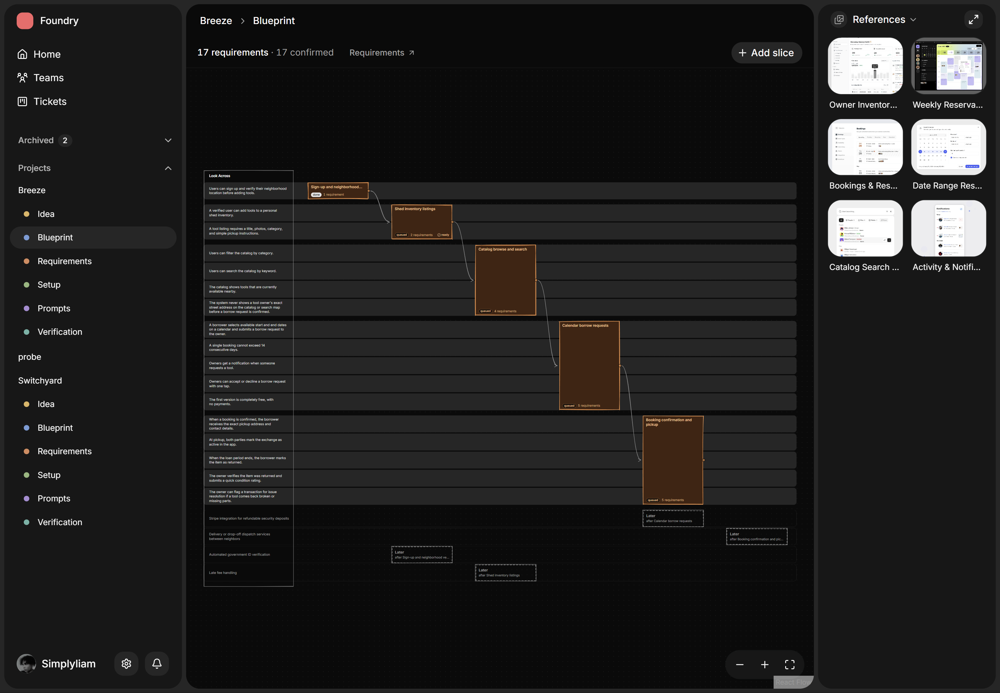
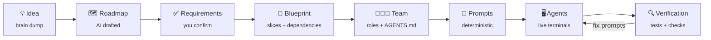
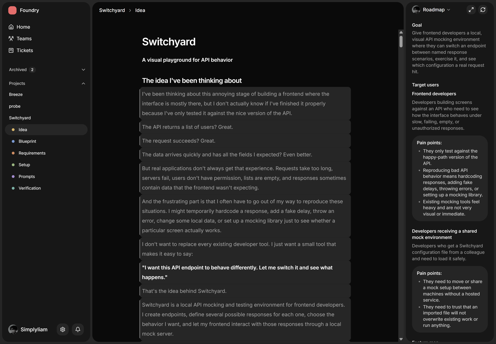
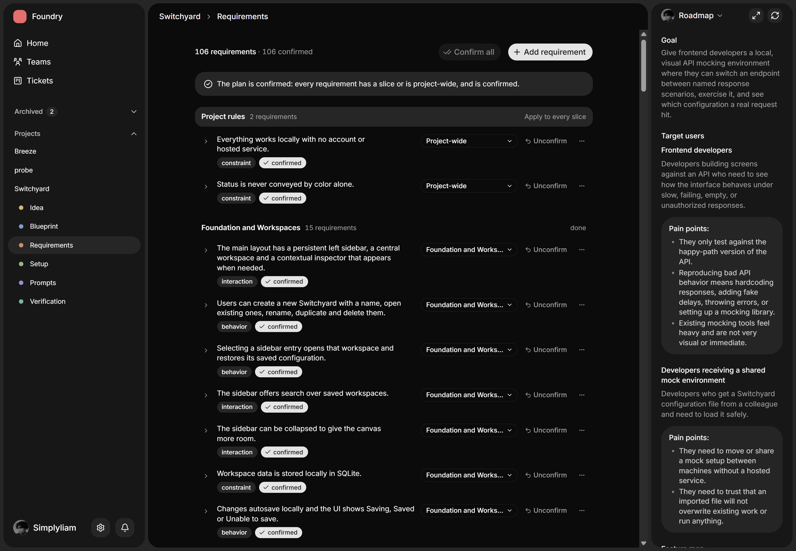
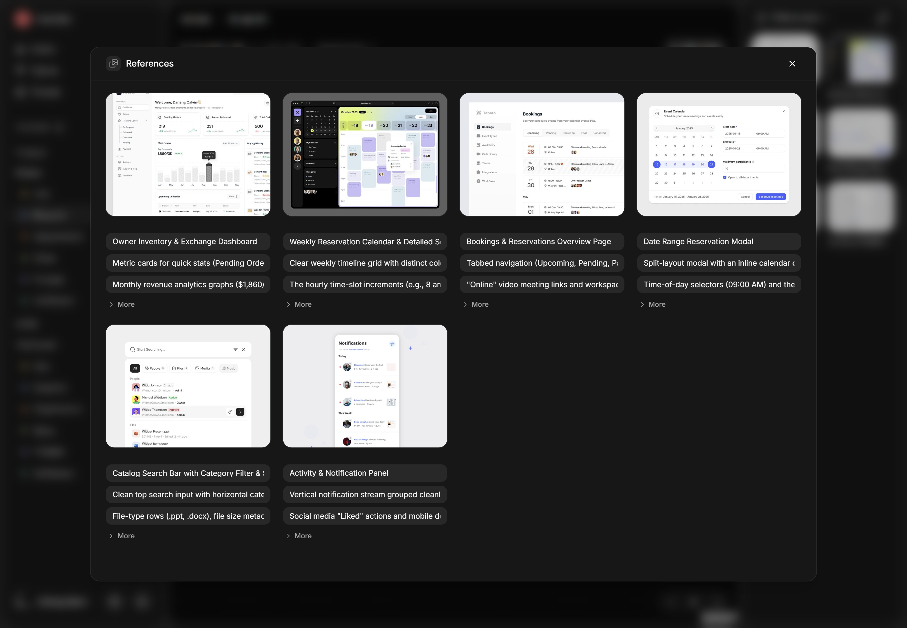
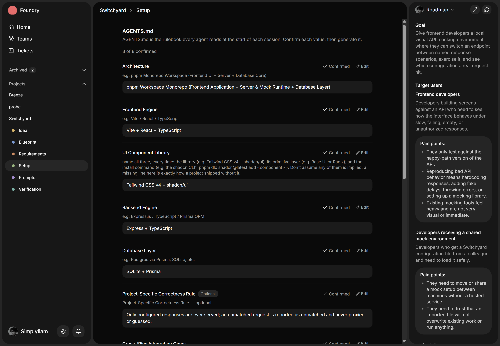
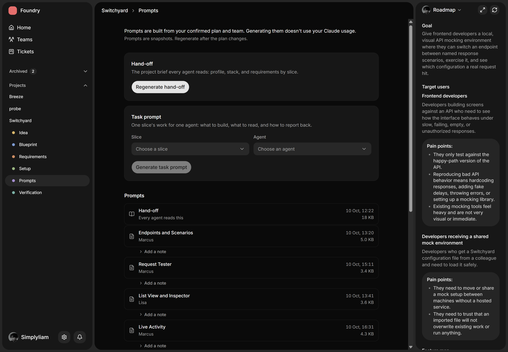
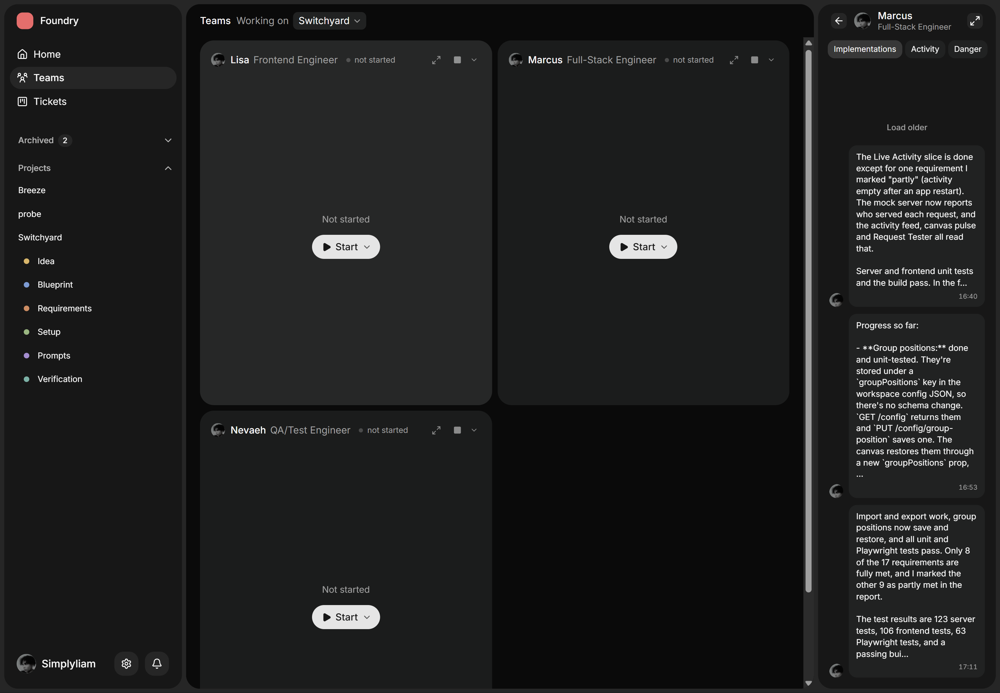
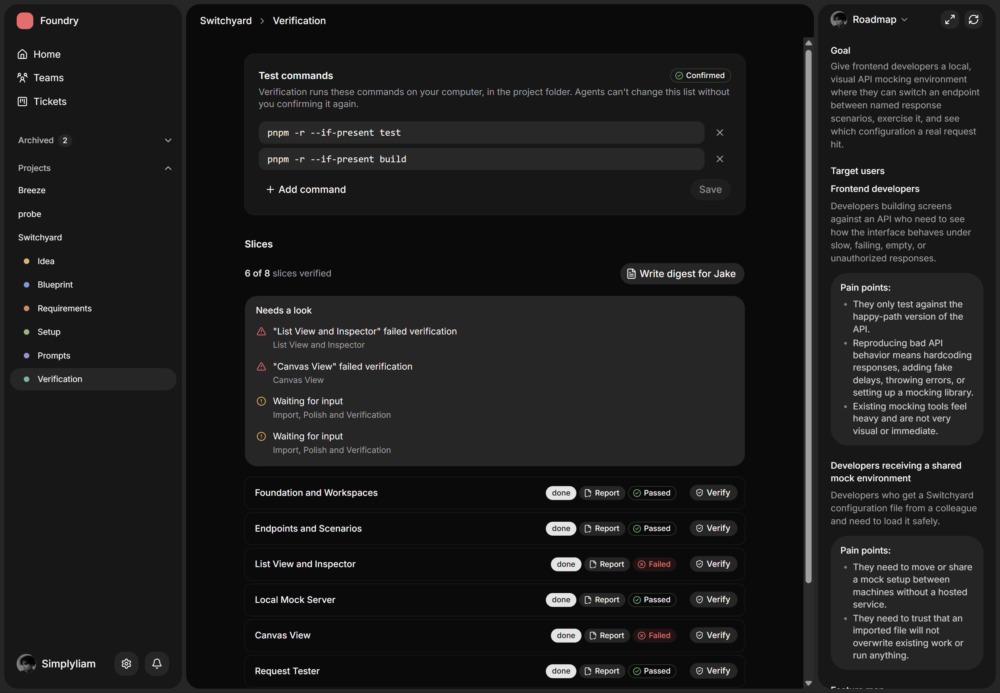

<div align="center">

# Foundry

**Mission control for building software with a team of AI coding agents.**

Foundry turns a messy idea into a confirmed plan, staffs it with a team of Claude Code agents,<br>
watches them work in live terminals, and checks their work before anything is marked done.


<br>



</div>

<br>

> [!NOTE]
> Foundry is a personal passion project. I built it to explore one question: *what would it take to run a small team of AI agents the way you'd run a real engineering team?* It works end to end, but it's an experiment, not a maintained product, and I may not keep iterating on it.

---

## The problem

AI coding agents are very good at writing code and weak at everything around it. Run a few of them on a real project and the same problems keep coming up:

- **The plan lives in your head.** The agent gets a paragraph, fills the gaps with guesses, and quietly drops the requirements you never wrote down.
- **Parallel agents step on each other.** Two agents edit the same files, and nobody owns the boundaries between their work.
- **"Done" means "the agent said so."** Reports claim tests pass and rules were followed. Nothing checks.
- **You can't see what's going on.** Three terminals scroll past. You miss the one agent that's stuck, blocked, or about to run `git push`.
- **Context is rebuilt by hand.** Every session starts with copying the brief, the stack, the design references and the task back into a prompt.

## The idea

Foundry treats AI agents like a team that needs a good manager. It gives you one desktop app that covers the whole loop, from *"here's my idea"* to *"this slice is verified and committed"*:



The model only drafts. **Nothing an AI proposes is saved until you confirm it**, and every handoff between steps is plain files in your own repo (JSON, JSONL and Markdown) that you can read, diff and commit.

---

## What it can do

### 💡 From brain dump to roadmap

Write your idea the way you'd explain it to a friend. Foundry asks Claude for a structured roadmap: goal, target users and their pain points, a feature map, build slices, requirements and open questions.

- Every requirement carries a **verbatim excerpt from your brain dump**. Foundry checks the quote word for word, and anything it can't trace is flagged as *unsourced* instead of being silently trusted.
- A **"Needs a look"** list shows the parts of your brain dump the roadmap *didn't* pick up, so ideas don't fall through the cracks.
- Output is validated (schema, duplicate slices, dependency cycles named like `A → C → B → A`) and retried once with the errors before anything reaches disk.



### ✅ Requirements you actually confirm

Each requirement is a *behavior*, *interaction* or *constraint* assigned to a slice or marked project-wide. The plan only counts as confirmed when the graph has no cycles and every requirement is assigned and approved.

- **Requirement checks** turn rules into things a machine can verify: `file_exists`, `dependency_absent` (*"use Base UI, not Radix"*), `text_absent` with a regex, and more. The AI can suggest checks; you accept them.
- **Conflict detection** spots when your brain dump contradicts your design references (*"no minimap"* versus a reference image that has one) and asks you to rule on it before agents pick a side.



### 🧩 Blueprint: the plan as a graph

The Blueprint (pictured at the top) lays out every slice as a node in a dependency graph, with its requirements beside it. Add slices, wire up dependencies, track status (`queued → in progress → done`) and park out-of-scope ideas in a **Later** lane anchored to the slice they follow. A slice can't be marked done until its dependencies are.

### 🎨 References (the Bakery)

Drop or paste screenshots into a mood board. Each image gets a label, what to **take** from it, what to **skip**, and which slices it applies to. Foundry writes a manifest that agents read, so "make it look like this" comes with specific notes instead of a vague vibe.



### 🧑‍🤝‍🧑 Team composition and AGENTS.md

Pick roles from a **Role Handbook** (12 starter roles, fully editable, importable from Markdown) or let Claude propose a team sized to your slices. Then fill in the project's rulebook (architecture, frontend, backend, database, correctness rules), confirm each value, and Foundry generates the `AGENTS.md` every agent reads at the start of a session.



### 📝 Prompts built by code, not by a model

Hand-off and task prompts are put together **deterministically** from your confirmed plan, team, references and rules: same inputs, same bytes, and no Claude usage spent. Each task prompt has a fixed structure that tells one agent exactly which slice to build, what to read, which files they own, and the JSON report shape to return. You can add notes per prompt.



### 🖥️ Live agent terminals and Agent Chats

Start agents straight from the app. Each one runs Claude Code in a real pseudo-terminal (`portable-pty` + `xterm.js` with WebGL rendering), with a cap on how many run at once.

- A small **hook helper** installed into the project streams every agent action back to Foundry: edits, commands, test runs, blocked actions, turns completed.
- Foundry spots agents that are **stuck** (repeated failures) or **quiet** (no activity for 10 minutes), and warns on risky moves like `git push` or installing dependencies.
- **Agent Chats** gathers each agent's reports and activity in one feed, with filters for implementations, activity and danger, and optional desktop notifications.



### 🔍 Verification that doesn't take the agent's word for it

When an agent reports a slice finished, Foundry checks the work itself:

- Runs your **confirmed test commands** in the project folder. Agents can't change that list without you confirming it again.
- Runs every **requirement check** for the slice and the project-wide rules.
- Compares what each agent **actually wrote** against the files they were allowed to own.
- Marks a verification **stale** if the report changes afterwards.

It then explains the result in plain words (*needs fix*, *needs decision*, *safe to override*, *passed*) with one-click next steps. QA agents can file structured bugs, and Foundry routes **fix prompts** to whichever agent owns the affected files. Passing slices can be **committed from the app** with a generated message, and a **manager digest** sums up the whole project.



---

## Under the hood

| Layer | Tech |
| --- | --- |
| Desktop shell | [Tauri v2](https://tauri.app) with a custom frameless window (native corner radius detection on Windows 11) |
| Backend | Rust · tokio · serde · `portable-pty` · `image` · `tracing` · `tauri-plugin-notification` |
| Contract | TypeScript bindings generated from the Rust types with [tauri-specta](https://github.com/specta-rs/tauri-specta) |
| Frontend | React 19 (with the React Compiler) · TypeScript · Vite · Tailwind CSS v4 · shadcn/ui on Base UI · Motion |
| Editors and canvases | Tiptap (Markdown brain dump) · React Flow (Blueprint graph) · xterm.js with WebGL (agent terminals) |
| AI | [Claude Code](https://docs.anthropic.com/en/docs/claude-code) CLI on the user's own subscription, plus Claude Code hooks |
| Storage | No database: JSON, JSONL and Markdown files in the linked repo and app data |

### Engineering highlights

- **A typed, versioned contract.** Every Tauri command and event is typed end to end. Each change is logged in [`CONTRACT_CHANGELOG.md`](src-tauri/CONTRACT_CHANGELOG.md) (name, before → after, why), and breaking changes need explicit approval.
- **Safe by default with your repo.** Foundry can only write to an allowlist of paths inside a linked project. Writes are atomic (temp file + rename), path escapes (`..`, symlinks, absolute paths) are refused, and settings files are merged rather than overwritten, with a backup first.
- **Feature-sliced on both sides.** Rust features import only `core`, never each other. On the frontend, widgets are thin shells over feature folders, with clear import rules (see [`src/AGENTS.md`](src/AGENTS.md)).
- **Tested for real.** 600+ Rust tests run black-box against real temp directories and real child processes (a fake `claude` and a fake agent binary), with no filesystem mocks. The frontend runs Vitest + Testing Library against a typed fake backend built from the generated bindings.
- **No `unwrap` in production code.** Every command returns `Result<T, AppError>` with a stable, machine-readable error code, and the UI shows the backend's message as-is.
- **Decisions are written down.** Non-obvious UI decisions are recorded one line at a time in [`src/DECISIONS.md`](src/DECISIONS.md).

### How it was built

Foundry was built with the same workflow it supports. Frontend and backend work were split between separate agents with strict boundaries (each with its own `AGENTS.md`), held together by the generated, typed contract, with me as the person approving the plan, every contract change and the final result.

---

## Getting started

### Prerequisites

- [Node.js](https://nodejs.org) 20+
- [Rust](https://rustup.rs) (stable) and the [Tauri prerequisites](https://tauri.app/start/prerequisites/) for your OS
- The Tauri CLI: `npm install -g @tauri-apps/cli` (or `cargo install tauri-cli`)
- [Claude Code](https://docs.anthropic.com/en/docs/claude-code) installed and signed in with a Claude subscription (needed for roadmap generation, team proposals and running agents)

### Run it

```bash
git clone https://github.com/simplyyliam/foundry.git
cd foundry
npm install
npm run tauri     # builds the hook helper, starts Vite and opens the app
```

### Useful scripts

| Command | What it does |
| --- | --- |
| `npm run tauri` | Run the desktop app in development |
| `npm test` | Frontend tests (Vitest) |
| `npm run typecheck` | TypeScript type-check |
| `npm run lint` | Lint with oxlint |
| `cd src-tauri && cargo test` | Backend tests |

> [!TIP]
> Opening and browsing projects doesn't use any Claude usage. Only **Generate roadmap**, **Compose team** and **Start agent** call Claude Code.

---

## Project structure

```
foundry/
├── src/                      React frontend
│   ├── pages/app/            File-based routes (projects, teams, tickets…)
│   ├── widgets/              Thin shells that assemble features
│   ├── features/<name>/      components/, hooks/, lib/ per feature
│   ├── shared/               Shared hooks and components (e.g. usePressScale)
│   └── lib/bindings.ts       Generated from Rust, never hand-edited
├── src-tauri/                Rust backend
│   ├── src/core/             AppError, safe paths, atomic writes, events
│   ├── src/features/<name>/  One module per feature (plan, roadmap, team, verification…)
│   ├── src/bin/foundry-hook  Small helper that forwards Claude Code hooks to the app
│   └── resources/templates/  Hand-off prompt and AGENTS.md templates
└── docs/                     Screenshots and planning notes
```

---

## Status and limitations

Foundry is an experiment I built for fun and learning, so a few things are worth knowing:

- It has mostly been built and tested on **Windows 11**. Tauri is cross-platform, but macOS and Linux haven't been tried properly.
- **Home** and **Tickets** are placeholders. Tickets, API-key auth, cloud sync and multiple repos per project were deliberately left out of scope.
- It runs on your own Claude subscription through the Claude Code CLI, so agent runs use your plan's usage.

If you're curious about any part of it, the [contract changelog](src-tauri/CONTRACT_CHANGELOG.md) is the best tour of how the pieces fit together.

<div align="center">
<br>

Built by **Liam** · [@simplyyliam](https://github.com/simplyyliam)

</div>
